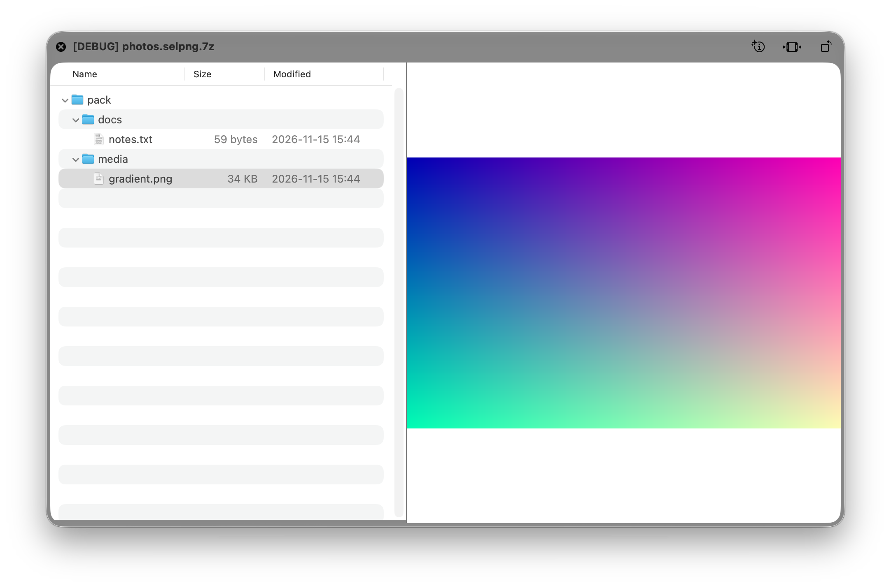

# QuickLookArchive

A Quick Look extension for macOS that previews the contents of archive files. Press Space on an archive in Finder to see a tree of its files. Select a file in the tree to see its contents (text, images and PDF).

Archives are read with `libarchive`, which ships with macOS.



## Supported files

Quick Look only hands QuickLookArchive the file types that macOS already knows. These work:

zip, tar, tar.gz / tgz, tar.bz2, tar.xz, gz, bz2, xz, 7z, cpio, xar, iso, epub: tested in Quick Look.

rar, cab, lha, lz, Z, jar, war, apk: registered, but not tested in Quick Look.

Types without a system definition (zst, lz4, lzma, deb, rpm, ar, whl, vsix, nupkg, xpi) still show Finder's plain info card. I tried declaring custom types and Quick Look ignored them.

## Requirements

- macOS 14 or later
- Xcode (full app, not only the command line tools)
- [xcodegen](https://github.com/yonaskolb/XcodeGen), only if you change `project.yml` (`brew install xcodegen`)

No Apple Developer account is needed. The build is signed ad hoc ("Sign to Run Locally").

## Build

The Xcode project is committed. To regenerate it after editing `project.yml`:

```sh
xcodegen
```

To build:

```sh
xcodebuild -project QuickLookArchive.xcodeproj -scheme QuickLookArchive \
  -configuration Debug -derivedDataPath build build
```

The app is at `build/Build/Products/Debug/QuickLookArchive.app`.

## Install

Quick Look finds the extension inside an app, so the app must be copied to an Applications folder and registered:

```sh
LSR=/System/Library/Frameworks/CoreServices.framework/Frameworks/LaunchServices.framework/Support/lsregister

mkdir -p ~/Applications
rm -rf ~/Applications/QuickLookArchive.app
cp -R build/Build/Products/Debug/QuickLookArchive.app ~/Applications/
$LSR -f -R ~/Applications/QuickLookArchive.app
pluginkit -a ~/Applications/QuickLookArchive.app/Contents/PlugIns/QuickLookArchivePreview.appex
pluginkit -e use -i pt.telmofcosta.quicklookarchive.preview
killall quicklookd QuickLookUIService
qlmanage -r
```

To reinstall after a rebuild, run the same commands. If an old copy is registered, remove it first:

```sh
$LSR -u ~/Applications/QuickLookArchive.app
pluginkit -r ~/Applications/QuickLookArchive.app/Contents/PlugIns/QuickLookArchivePreview.appex
```

## Try it

```sh
qlmanage -p some-archive.zip
```

Or select an archive in Finder and press Space.

## Uninstall

```sh
$LSR -u ~/Applications/QuickLookArchive.app
pluginkit -r ~/Applications/QuickLookArchive.app/Contents/PlugIns/QuickLookArchivePreview.appex
rm -rf ~/Applications/QuickLookArchive.app
qlmanage -r
```

## Limits

- Listings stop at 50,000 entries.
- A file preview reads at most 8 MB.
- Nested archives (a zip inside a zip) show "No preview for this file type".
- A single compressed file (for example `notes.txt.gz`) is shown as one entry.

## Layout

- `App/`: the host app. It only exists to carry the extension.
- `Extension/`: the Quick Look extension.
  - `ArchiveReader.swift`: lists and reads archives through libarchive.
  - `CArchive.h`: hand-written libarchive declarations, because the SDK has no public header.
  - `ArchiveTree.swift`: builds the folder tree.
  - `PreviewViewController.swift`: the tree view and split layout.
  - `FilePreviewView.swift`: the right pane for text, images and PDF.
- `project.yml`: the xcodegen spec.
